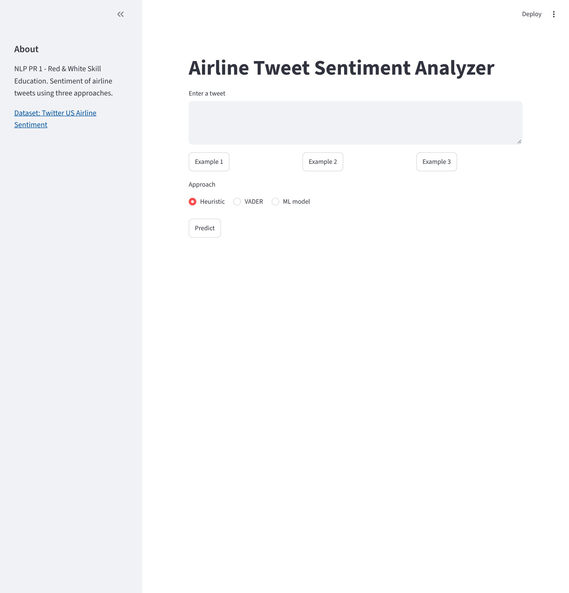
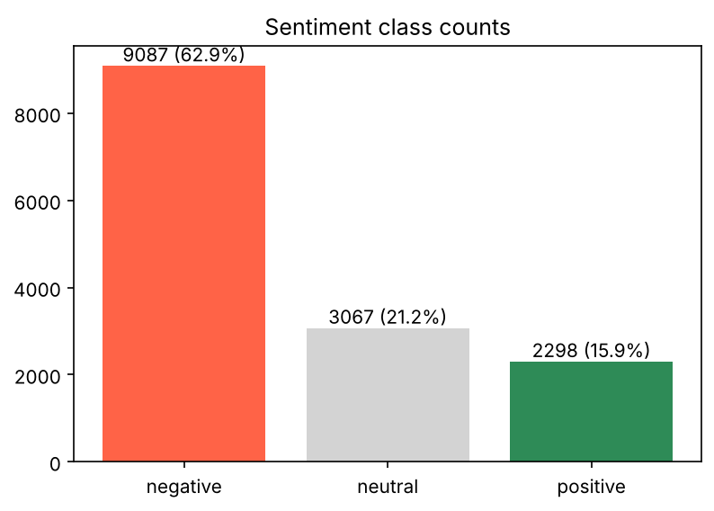
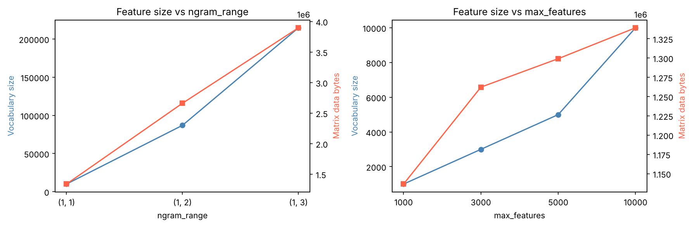
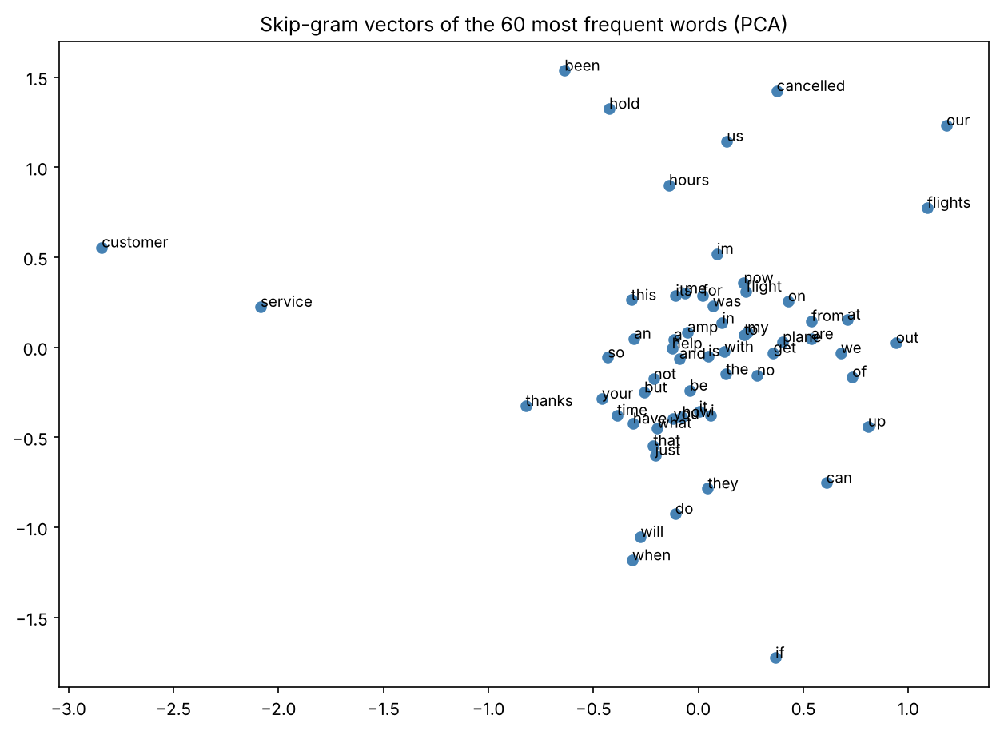
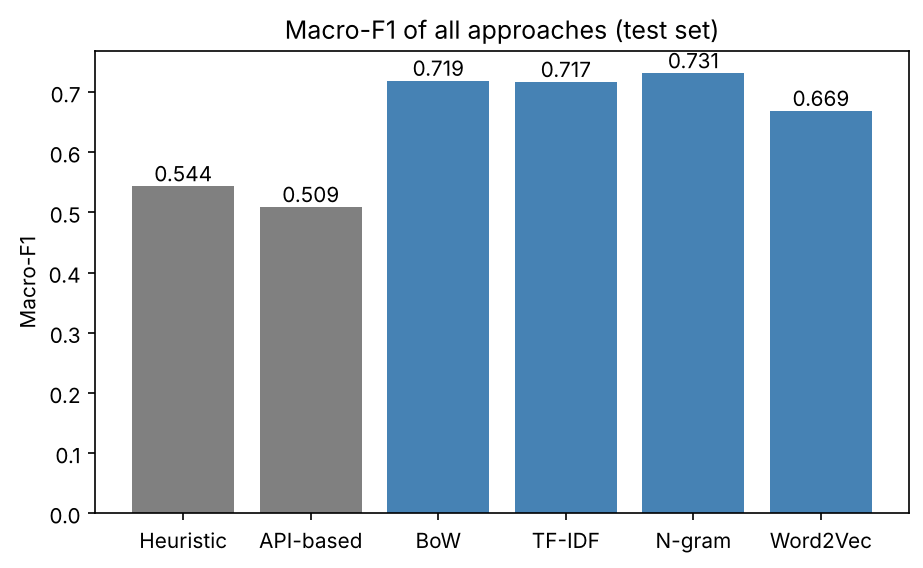
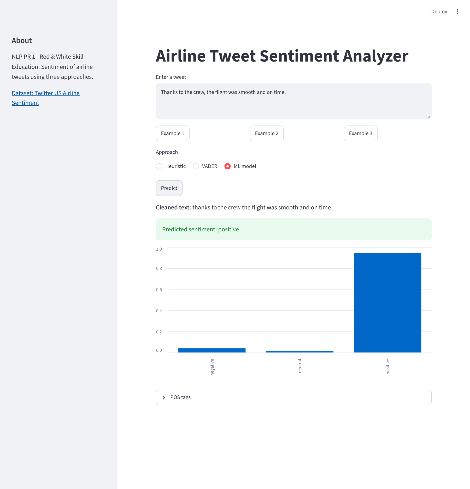
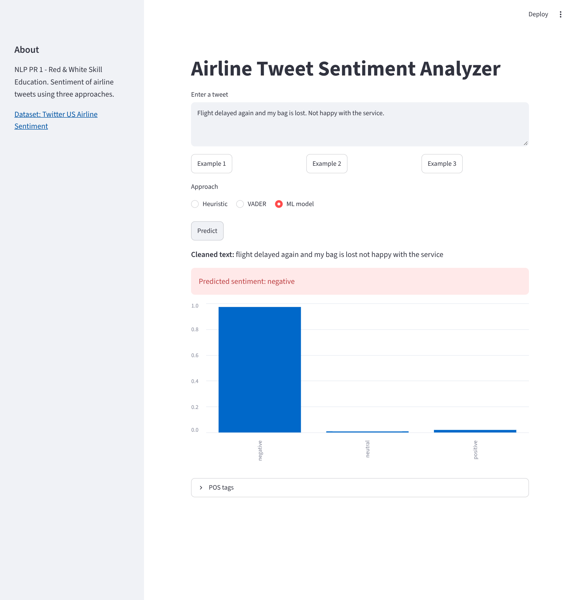
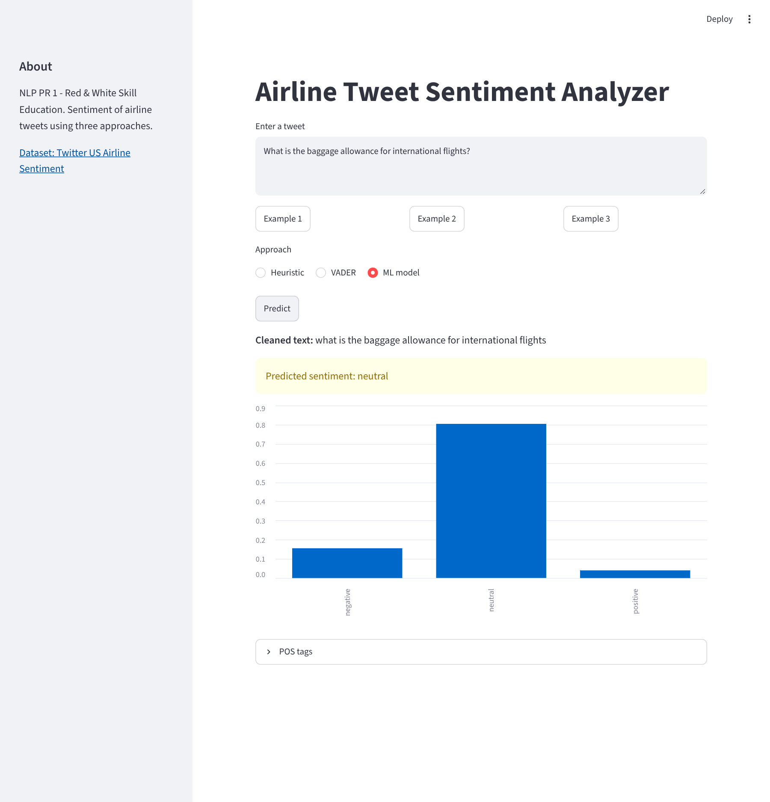
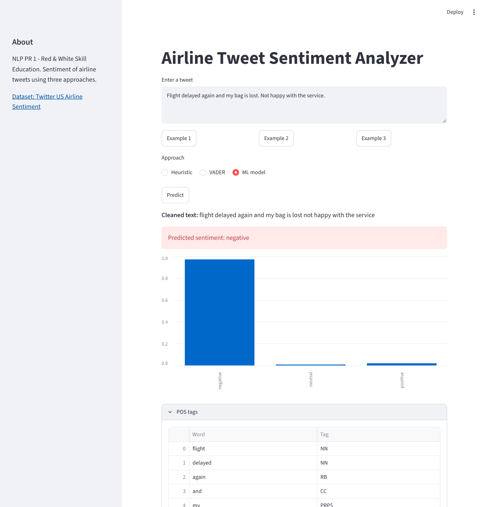

<div align="center">

[](https://YOUR-APP-NAME.streamlit.app)

**🔗 Live Streamlit URL:** https://airline-tweet-sentiment-analyzer-nlp-1.streamlit.app/


<br>

[](#)
[](#)
[](https://www.kaggle.com/datasets/crowdflower/twitter-airline-sentiment)
[](#-results-comparison)

<br>


</div>

<br>

## 🖥️ App Preview

<div align="center">



*The Streamlit app: text box, example buttons, approach selector and Predict button.*

</div>

<br>

## 🎬 Video Walkthrough

<div align="center">

[](https://drive.google.com/file/d/1WWYS7KcfMxWoJYRmMUgZdvupSaYDV6mo/view?usp=sharing)

🎥 **A complete video explanation (face + screen, 5–10 min)** covering the NLP pipeline, key RegEx patterns and why negations are kept, heuristic vs API-based vs ML results, BoW vs TF-IDF, what N-grams add and cost, CBoW vs Skip-gram, how a POS tagger uses context, why the vectoriser is fitted on training data only, and a **live test of the deployed app** with new inputs.

> 📌 *Click the button above or [open the video directly →](https://drive.google.com/file/d/1WWYS7KcfMxWoJYRmMUgZdvupSaYDV6mo/view?usp=sharing)*

</div>

---

## 🎯 About This Project

> A computer cannot read a tweet the way a person does. Before any model can learn from text, the text must be cleaned, split, and turned into numbers. This project walks through every one of those steps on real, noisy airline tweets.

The project classifies tweets about six US airlines as **negative, neutral or positive** and compares **three NLP approaches** on the same test set: hand-written rules, a ready-made sentiment engine (VADER), and machine-learning models trained on **Bag-of-Words, TF-IDF, N-grams and Word2Vec**. The best pipeline is saved and deployed as a Streamlit web app.

<div align="center">

```
░░░░░░░░░░░░░░░░░░░░░░░░░░░░░░░░░░░░░░░░░░░░░░░░░░░░░░░░░░░
   Data → Cleaning (RegEx) → Tokenisation → Stop-words
   ───────────────────────────────────────────────────────
   Heuristic rules  |  VADER (API-based)  |  ML models
   ───────────────────────────────────────────────────────
   BoW → TF-IDF → N-grams → Word2Vec (CBoW / Skip-gram)
   ───────────────────────────────────────────────────────
   Pipeline → Evaluation → POS tagging → Streamlit app
░░░░░░░░░░░░░░░░░░░░░░░░░░░░░░░░░░░░░░░░░░░░░░░░░░░░░░░░░░
```

</div>

<br>

---

## 📚 Dataset

| Item | Detail |
|:---|:---|
| **Name** | Twitter US Airline Sentiment |
| **Source** | [Kaggle – crowdflower/twitter-airline-sentiment](https://www.kaggle.com/datasets/crowdflower/twitter-airline-sentiment) |
| **File** | `Tweets.csv` (not stored in this repository, download it from Kaggle) |
| **Size** | About 14,640 tweets, 3 columns used: `text`, `airline_sentiment`, `airline` |
| **Classes** | Negative (about 63%), neutral (about 21%), positive (about 16%) |
| **Split** | 80 / 20 stratified, `random_state=42`, done **before** fitting any vectoriser |
| **Main metric** | **Macro-F1** (the classes are imbalanced, so accuracy alone is misleading) |
| **Licence** | Published by CrowdFlower (Figure Eight), free for educational use |

> ⚠️ Download `Tweets.csv` from Kaggle (free account needed) and place it next to the notebook.

<br>

---

## ✨ What Makes This Project Stand Out

<table>
<tr>
<td width="50%" valign="top">

### 🧮 Built by Hand, Then Verified
- Bag-of-Words built with a Python `Counter`, then matched with `CountVectorizer`
- TF-IDF computed manually with `ln(N/df) + 1` and matched with `TfidfVectorizer` using `np.allclose`
- Own airline sentiment lexicon with negation handling

</td>
<td width="50%" valign="top">

### 🧹 Careful Text Cleaning
- Every RegEx pattern tested on small examples first
- Negation words (`not`, `no`, `never`, `dont`…) kept, so "not happy" is never turned into "happy"
- Empty-after-cleaning tweets reported and handled

</td>
</tr>
<tr>
<td width="50%" valign="top">

### 📊 Fair Comparison
- Heuristic, VADER, BoW, TF-IDF, N-gram and Word2Vec on the **same** test set
- Vectoriser fitted on training data only (no leakage)
- 5-fold stratified cross-validation and error analysis of 8 tweets

</td>
<td width="50%" valign="top">

### 🚀 Real Deployment
- One shared `nlp_utils.py` used by notebook **and** app
- Three approaches selectable in the app
- Handles empty, very long, emoji-only and URL-only input

</td>
</tr>
</table>

<br>

---

## 🗺️ Full Project Journey

<div align="center">

| Task | Focus | Key Output |
|:---:|:---|:---|
| 🚀 **Task 1** | NLP basics, pipeline, data exploration | Dataset checks · 3 EDA plots · 5 real tweets showing NLP challenges |
| 🧹 **Task 2** | RegEx cleaning and tokenisation | Tested patterns · `clean_text()` · stop-words with negations kept · vocabulary statistics |
| ⚖️ **Task 3** | Heuristic and API-based approaches | Own lexicon · VADER · same-test-set evaluation · failure cases |
| 🔢 **Task 4** | Feature extraction | BoW and TF-IDF by hand and sklearn · N-grams · feature-size experiment |
| 🧠 **Task 5** | Word2Vec | CBoW and Skip-gram · similar words · PCA plot · document vectors |
| 🏁 **Task 6** | Classification pipeline and comparison | 5 feature/classifier combinations · all approaches in one chart · CV · error analysis · saved model |
| 🏷️ **Task 7** | POS tagging | Tagged tweets · POS distribution by sentiment · POS-filtered features |
| 🌐 **Task 8** | Streamlit app | Local app · screenshots · deployment on Streamlit Community Cloud |

</div>

<br>

---

## 🔄 Pipeline Summary

<div align="center">

| Stage | What was done on the airline tweets |
|:---:|:---|
| 1️⃣ Data collection | Load `Tweets.csv`, drop duplicates |
| 2️⃣ Text cleaning | Lowercase, remove URLs, @mentions, numbers and punctuation, keep hashtag words |
| 3️⃣ Tokenisation | Split with NLTK `word_tokenize` |
| 4️⃣ Stop-words | NLTK list, but negations are kept |
| 5️⃣ Features | BoW, TF-IDF, N-grams, averaged Word2Vec |
| 6️⃣ Model | Logistic Regression, Multinomial Naive Bayes |
| 7️⃣ Evaluation | Accuracy, macro-F1, confusion matrix, 5-fold CV |
| 8️⃣ Deployment | Saved `joblib` pipeline inside a Streamlit app |

</div>

<br>

---

## 🧠 The Key Ideas

### 🧹 Why clean text with RegEx?
Tweets contain links, @mentions, hashtags, emojis and typos. RegEx patterns such as `https?://\S+` and `@\w+` remove the noise, and `#(\w+)` keeps the hashtag word. Negation words are **kept**, because removing `not` from "not happy with the delay" would reverse the meaning.

<div align="center">



*Negative tweets are the clear majority, so macro-F1 is used instead of accuracy.*

</div>

### 🔢 BoW, TF-IDF and N-grams
Bag-of-Words counts words, TF-IDF down-weights words that appear in many tweets, and N-grams keep short phrases such as "not happy". Larger n gives more information but a much bigger and sparser vocabulary.

<div align="center">



*Vocabulary size and matrix memory against `ngram_range` and `max_features`.*

</div>

### 🧠 Word2Vec
BoW treats every word as unrelated. Word2Vec gives each word a dense vector, so words used in similar contexts get similar vectors. **CBoW** predicts the centre word from its context, **Skip-gram** predicts the context from the centre word. The corpus is small, so the vectors are noisier than ones trained on huge text collections.

<div align="center">



*PCA plot of the 60 most frequent words (Skip-gram vectors).*

</div>

### 🏷️ POS tagging
A part-of-speech tagger labels every word as noun, verb, adjective and so on, using the word and its neighbours. NLTK's `pos_tag` was trained on news text, so it makes mistakes on informal tweets.

<br>

---

## 📊 Results Comparison

| Approach | Features | Classifier | Accuracy | Macro-F1 |
|:---|:---|:---|:---:|:---:|
| Heuristic | Own lexicon | Rules | 0.527 | 0.544 |
| API-based | VADER | Lexicon engine | 0.543 | 0.509 |
| BoW | Word counts | Multinomial NB | 0.761 | 0.657 |
| BoW | Word counts | Logistic Regression | 0.768 | 0.719 |
| TF-IDF | Unigrams | Logistic Regression | 0.767 | 0.717 |
| **N-gram** | **TF-IDF uni + bigrams** | **Logistic Regression** | **0.784** | **0.731** 🏆 |
| Word2Vec | Averaged Skip-gram vectors | Logistic Regression | 0.719 | 0.669 |

<div align="center">



*Macro-F1 of all six approaches on the same test set.*

</div>

**Deployed model:** `TfidfVectorizer(ngram_range=(1,2), min_df=2)` + `LogisticRegression(class_weight='balanced')`, the best macro-F1 of all approaches.
**5-fold CV macro-F1:** `0.742 ± 0.009` &nbsp;|&nbsp; **Test macro-F1:** `0.731` (close to CV, so the model is stable).
**POS-filtered features** (Task 7.5) lowered macro-F1 by 0.102, so they were not used.

<br>

---

## 📸 App Screenshots

<table>
<tr>
<td align="center" width="50%">

<br><sub><b>Positive prediction</b> – green result box</sub>
</td>
<td align="center" width="50%">

<br><sub><b>Negative prediction</b> – red result box</sub>
</td>
</tr>
<tr>
<td align="center" width="50%">

<br><sub><b>Probability chart</b> – class probabilities of the ML model</sub>
</td>
<td align="center" width="50%">

<br><sub><b>POS expander</b> – part-of-speech tags of the tweet</sub>
</td>
</tr>
</table>

### 🛡️ App Features
- Three approaches: **Heuristic**, **VADER** and **ML model**
- Three example tweets that fill the text box
- Cleaned text, coloured sentiment message and probability bar chart
- Warnings for empty input, text that is empty after cleaning, and input longer than 500 characters (truncated)
- NLTK data downloaded safely at start-up


<br>

---

## 🧪 What This Project Covers (Theory)

<details>
<summary><b>📖 Click to expand – NLP Concepts Covered</b></summary>
<br>

- What NLP is, why it is needed, common tasks and challenges
- The NLP pipeline from raw text to deployment
- Text cleaning with Regular Expressions and tokenisation
- Stop-words and why negation words must be kept
- Heuristic approach and API-based approach
- Bag-of-Words, TF-IDF (with the manual formula) and N-grams
- Word embeddings, Word2Vec, CBoW and Skip-gram
- Text classification pipeline and data leakage
- Macro-F1, confusion matrix and cross-validation
- POS tagging and how it works
- Deployment with Streamlit

</details>

<br>

---

## 🛠️ Tools & Versions

| Tool | Used For | Version |
|:---|:---|:---:|
| Python / Jupyter Notebook | Development | 3.12.3 |
| pandas / NumPy | Data handling, manual BoW and TF-IDF | 3.0.6 |
| NLTK | Tokenisation, stop-words, VADER, POS tagging | 3.10.4 |
| scikit-learn | Vectorisers, classifiers, metrics, pipeline | 1.9.1 |
| Gensim | Word2Vec (CBoW and Skip-gram) | 4.4.0 |
| Matplotlib | Plots | 3.11.2 |
| Streamlit | Web app and deployment | 1.66.1 |

> The same `scikit-learn` version must be used for training and deployment, because a model saved with one version may not load in another. Exact versions are in `requirements.txt`.

<br>

---

## 👨‍💻 Author

<div align="center">

### **Ayush Isamaliya**
*Data Science & Aspiring ML Engineer*

</div>

### 🌐 Connect With Me

<div align="center">

[]()
[]()

</div>

<br>

<div align="center">


**Built as part of the NLP track at Red & White Skill Education**


*Made with ❤️ | NLP PR-1 | From Raw Tweets to a Deployed App*

</div>
